# Yudea App — Panduan Pengguna

**GPIB Yudea · Sistem Informasi Warga Jemaat**

Panduan ini ditujukan untuk staf gereja, koordinator, dan administrator yang
menggunakan dashboard Yudea. Isinya menjelaskan fungsi setiap halaman, cara
menyelesaikan tugas sehari-hari, dan hal-hal yang dilakukan sistem secara
otomatis. Panduan ini tidak membahas instalasi atau pengembangan; lihat
[README.md](../README.md) dan berkas lain di `docs/` untuk itu.

> **Petugas baru?** Mulai dari [Panduan Cepat](QUICK_START.md) satu halaman,
> lalu kembali ke panduan ini untuk detailnya.

> **Tentang teks antarmuka:** aplikasi memakai campuran label Indonesia dan
> Inggris. Label ditulis di bawah ini persis seperti yang tampil di layar,
> misalnya **Warga Jemaat** dan **Sektor Pelayanan**.

**Terakhir diperbarui:** 8 November 2026

---

## Daftar isi

1. [Pendahuluan](#1-pendahuluan)
2. [Memulai](#2-memulai)
3. [Peran dan akses](#3-peran-dan-akses)
4. [Dashboard](#4-dashboard)
5. [Ulang Tahun](#5-ulang-tahun)
6. [Wilayah Pelayanan](#6-wilayah-pelayanan)
7. [Sektor Pelayanan](#7-sektor-pelayanan)
8. [Keluarga](#8-keluarga)
9. [Warga Jemaat](#9-warga-jemaat)
10. [Majelis Jemaat](#10-majelis-jemaat)
11. [Pelkat Members](#11-pelkat-members)
12. [Attendance](#12-attendance)
13. [Laporan Warga Jemaat](#13-laporan-warga-jemaat)
14. [Users](#14-users)
15. [Pengaturan akses berdasarkan peran](#15-pengaturan-akses-berdasarkan-peran)
16. [Tugas umum, langkah demi langkah](#16-tugas-umum-langkah-demi-langkah)
17. [Referensi kolom dan nilai](#17-referensi-kolom-dan-nilai)
18. [Pemecahan masalah dan FAQ](#18-pemecahan-masalah-dan-faq)
19. [Keamanan data](#19-keamanan-data)
20. [Lampiran: peta menu dan akun demo](#20-lampiran-peta-menu-dan-akun-demo)

---

## 1. Pendahuluan

Yudea adalah dashboard administrasi gereja. Aplikasi ini menyimpan struktur
jemaat dan data yang dibutuhkan pelayanan: wilayah, sektor, keluarga, warga
jemaat, kelompok pelayanan (Pelkat), majelis jemaat, kehadiran, dan laporan.

### Hubungan antar-data

```
Wilayah Pelayanan (cabang)
└── Sektor Pelayanan (sektor)
    └── Keluarga (rumah tangga)
        └── Warga Jemaat (anggota)
```

- Setiap **Keluarga** berada di tepat satu **Sektor Pelayanan**.
- Setiap **Sektor Pelayanan** berada di satu **Wilayah Pelayanan**.
- Setiap **Warga Jemaat** berada di tepat satu **Keluarga**.
- **Majelis Jemaat** dan **Pelkat** bukan daftar terpisah yang harus diisi.
  Keduanya adalah tampilan yang dihitung dari data warga jemaat.
- **Ulang Tahun**, **Attendance**, **Laporan**, dan **Dashboard** adalah
  ringkasan serta ekspor yang dibangun dari data di atas.

Karena struktur ini, sebagian data harus ada lebih dulu sebelum data lain bisa
diisi. Misalnya, warga jemaat tidak bisa ditambahkan sebelum keluarganya
dibuat.

---

## 2. Memulai

### 2.1 Yang Anda butuhkan

- Peramban modern (Chrome, Edge, Firefox, atau Safari) dan koneksi internet.
- Alamat dashboard dari administrator (biasanya
  `https://<domain-gereja-anda>/`).
- Akun pengguna. Akun dibuat oleh administrator di halaman **Users**; tidak ada
  pendaftaran mandiri.

### 2.2 Masuk

1. Buka alamat dashboard. Halaman login (**Login**) tampil di `/public/login`.
2. Isi **Email** dan **Password**.
3. Gunakan tombol mata di kanan kolom password untuk menampilkan atau
   menyembunyikan password saat mengetik.
4. Klik **Login**.

Jika kredensial salah, halaman menampilkan **"Invalid email or password"**.
Password membedakan huruf besar dan kecil; pastikan Caps Lock tidak aktif.
Jika lupa password, minta administrator membuatkan password baru.

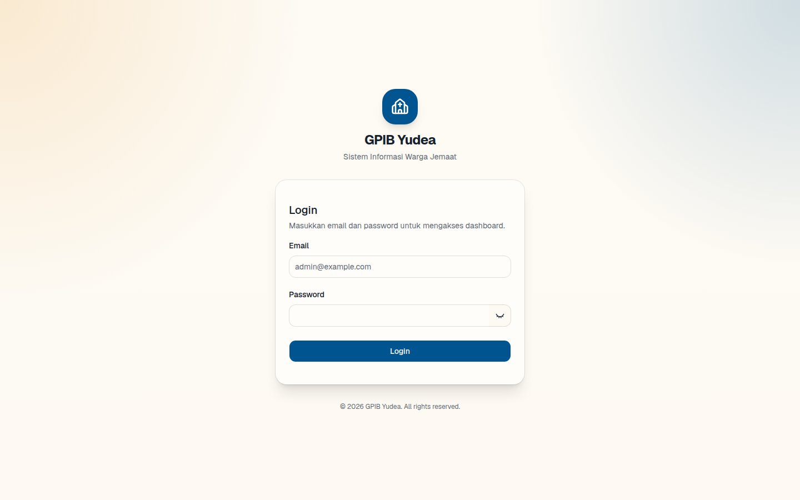

Setelah berhasil masuk, Anda diarahkan ke halaman awal sesuai peran:

| Peran | Halaman awal |
|-------|--------------|
| ADMIN, STAFF | **Dashboard** |
| COORDINATOR | **Keluarga** |
| MEMBER | **Warga Jemaat** |

**Perilaku sesi:** Anda tetap masuk sampai logout atau sesi berakhir. Jika
sebuah halaman tiba-tiba mengembalikan Anda ke layar login, masuk kembali.

### 2.3 Berpindah halaman

- **Sidebar** (kiri) menampilkan halaman yang boleh Anda buka. Halaman aktif
  disorot. Menu yang tidak menjadi hak akses Anda disembunyikan.
- Di ponsel atau jendela sempit, sidebar tersembunyi di balik **tombol menu**
  (☰) di bilah atas.
- Bilah atas menampilkan nama halaman saat ini, peran, dan alamat email Anda.
- Klik **avatar** (kanan atas) untuk membuka menu akun dan memilih **Logout**.

### 2.4 Kontrol tabel yang umum

Sebagian besar halaman memakai tata letak tabel yang sama:

| Kontrol | Fungsinya |
|---------|-----------|
| Kolom pencarian | Menyaring daftar saat Anda mengetik. Pencarian kembali ke halaman 1. |
| Judul kolom | Klik untuk mengurutkan. Klik lagi untuk membalik urutan. Panah menunjukkan arah saat ini. |
| Baris per halaman (`10 / page`) | Pilih 10, 20, atau 50 baris. Perubahan mengembalikan ke halaman 1. |
| Tombol `<` dan `>` | Halaman sebelumnya / berikutnya. `Showing 1-10 of 57` menunjukkan posisi Anda. |
| Tombol **Create …** | Membuka formulir tambah. Hanya tampil jika peran Anda boleh mengedit halaman itu. |
| **Edit** / **Delete** | Aksi per baris. Edit dan hapus juga dibatasi peran. |

Pengurutan diingat di address bar (`?sortBy=…&sortOrder=…`), sehingga tampilan
terurut bertahan saat halaman dimuat ulang. Pencarian dan filter tidak
disimpan di address bar, kecuali di halaman Warga Jemaat saat Anda datang dari
tabel sektor di dashboard.

### 2.5 Keluar

Buka menu avatar dan pilih **Logout**. Selalu logout saat memakai komputer
bersama.

---

## 3. Peran dan akses

Setiap akun memiliki satu peran. Peran menentukan menu yang muncul di sidebar,
tombol yang terlihat, dan data yang diterima server.

| Peran | Penggunaan umum |
|-------|-----------------|
| **ADMIN** | Akses penuh, termasuk Users dan Settings. |
| **STAFF** | Entri data harian: warga jemaat, keluarga, sektor, kehadiran, laporan. |
| **COORDINATOR** | Hanya bekerja dengan warga jemaat dan keluarga di sektor yang ditetapkan untuk akunnya. |
| **MEMBER** | Akses baca saja ke daftar warga jemaat dan majelis jemaat. |

### Akses halaman default

Ini adalah matriks default. Administrator dapat mengubah sebagian besar
pengaturan di halaman **Settings**.

| Halaman | Lihat | Edit |
|---------|-------|------|
| Dashboard | ADMIN, STAFF, COORDINATOR | ADMIN, STAFF |
| Ulang Tahun | ADMIN, STAFF, COORDINATOR | ADMIN, STAFF, COORDINATOR |
| Wilayah Pelayanan | ADMIN, STAFF | ADMIN, STAFF |
| Sektor Pelayanan | ADMIN, STAFF, COORDINATOR | ADMIN, STAFF |
| Keluarga | ADMIN, STAFF, COORDINATOR | ADMIN, STAFF, COORDINATOR |
| Warga Jemaat | ADMIN, STAFF, COORDINATOR, MEMBER | ADMIN, STAFF, COORDINATOR |
| Majelis Jemaat | ADMIN, STAFF, COORDINATOR, MEMBER | ADMIN, STAFF, COORDINATOR |
| Pelkat Members | ADMIN, STAFF | ADMIN, STAFF |
| Attendance | ADMIN, STAFF | ADMIN, STAFF |
| Report | ADMIN, STAFF | ADMIN, STAFF |
| Users | ADMIN | ADMIN |
| Settings | ADMIN | ADMIN |

**Lihat** berarti Anda boleh membuka halaman dan membaca datanya. **Edit**
berarti Anda boleh membuat, mengubah, menghapus, memisahkan keluarga, atau
mengubah status di halaman itu. Settings selalu terbatas untuk ADMIN, meskipun
matriks diubah.

Sebagian halaman hanya untuk tampilan (Dashboard, Ulang Tahun, Majelis Jemaat):
matriks mencantumkan izin Edit, tetapi tidak ada aksi edit di halamannya.
Halaman utama yang dapat diedit adalah Keluarga, Warga Jemaat, Sektor
Pelayanan, Wilayah Pelayanan, Attendance, dan Users.

### Pembatasan koordinator

Akun COORDINATOR terhubung ke satu **Sektor Pelayanan** saat akun dibuat. Untuk
pengguna tersebut:

- Data warga jemaat, keluarga, sektor, ulang tahun, dashboard, dan laporan
  dibatasi ke sektor itu.
- Membuat atau mengubah data di luar sektor yang ditetapkan akan ditolak.
- Daftar sektor dan total dashboard (termasuk kartu Pelkat) hanya menampilkan
  sektornya.

Jika koordinator perlu melihat sektor lain, administrator harus mengubah
sektor pada akunnya (dan pengguna harus masuk kembali).

### Layar "Access Restricted"

Jika Anda membuka halaman yang tidak boleh dilihat peran Anda, isinya diganti
dengan **Access Restricted**. Klik **Go to your dashboard** untuk kembali ke
halaman yang diizinkan. Ini adalah pengaturan izin, bukan kesalahan sistem;
hubungi administrator jika Anda merasa seharusnya memiliki akses.

---

## 4. Dashboard

Dashboard memberi ringkasan data yang boleh Anda lihat.

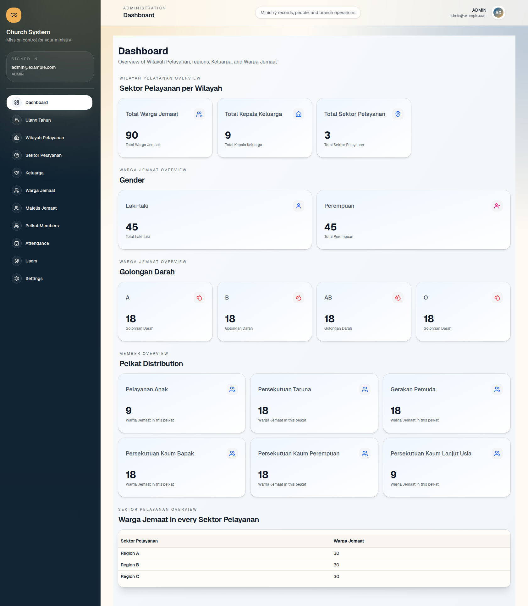

| Bagian | Isinya |
|--------|--------|
| **Wilayah Pelayanan Overview** | Total **Warga Jemaat**, total **Kepala Keluarga**, dan total **Sektor Pelayanan**. |
| **Gender** | Jumlah **Laki-laki** dan **Perempuan**. |
| **Golongan Darah** | Jumlah untuk golongan darah A, B, AB, dan O. |
| **Pelkat Distribution** | Satu kartu untuk setiap kategori Pelkat. |
| **Warga Jemaat in every Sektor Pelayanan** | Tabel sektor beserta jumlah warganya. Klik baris untuk membuka halaman Warga Jemaat yang sudah difilter ke sektor itu. |

Hal yang perlu diketahui:

- Total di bagian atas mencakup **semua** data warga jemaat, termasuk yang
  berstatus tidak aktif atau meninggal. Distribusi Pelkat hanya menghitung
  warga yang **aktif dan hidup**, jadi jumlahnya bisa lebih kecil dari total.
- Kartu **Total Kepala Keluarga** menghitung jumlah data keluarga/rumah tangga,
  bukan jumlah warga yang hubungannya Kepala Keluarga.
- Jumlah golongan darah dan gender dihitung dari data yang ada; nilai kosong
  atau tidak diketahui tidak dihitung dalam kategori mana pun.
- Akun koordinator melihat angka sektornya sendiri, bukan seluruh gereja.
- Angka disimpan sementara di cache. Jika baru mengubah data dan dashboard
  masih terlihat lama, muat ulang halaman untuk mengambil total terbaru.

---

## 5. Ulang Tahun

Halaman ini menampilkan warga jemaat yang berulang tahun pada minggu yang
dipilih.

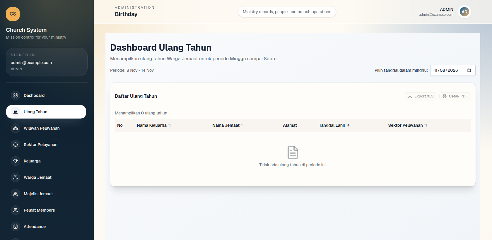

- Periodenya selalu **Minggu sampai Sabtu**; halaman menampilkan rentang
  persisnya, misalnya `Periode: 8 Nov - 14 Nov`.
- Kolom tanggal diisi tanggal hari ini. Pilih tanggal lain di minggu yang
  diinginkan untuk melihat minggu tersebut; satu minggu penuh selalu
  ditampilkan.
- Tabel memuat nama keluarga, nama warga, alamat, tanggal lahir, dan sektor.
  Urutkan dengan mengklik judul kolom. Saat mengurutkan berdasarkan tanggal
  lahir, urutannya memakai hari keberapa dalam setahun (bulan dan tanggal),
  bukan tahun lahir.
- **Export XLS** mengunduh daftar sebagai berkas Excel. **Cetak PDF** membuka
  dialog cetak peramban; pilih "Save as PDF" untuk membuat PDF.
- Kedua tombol ekspor nonaktif jika tidak ada ulang tahun pada minggu itu.
- Hanya warga yang **aktif** dan **hidup** yang ditampilkan.
- Koordinator hanya melihat ulang tahun di sektornya sendiri.

Usia tidak ditampilkan; hanya tanggal lahir yang tercantum.

---

## 6. Wilayah Pelayanan

**Wilayah Pelayanan** adalah cabang gereja. Ini tingkat teratas struktur dan
menaungi beberapa sektor.

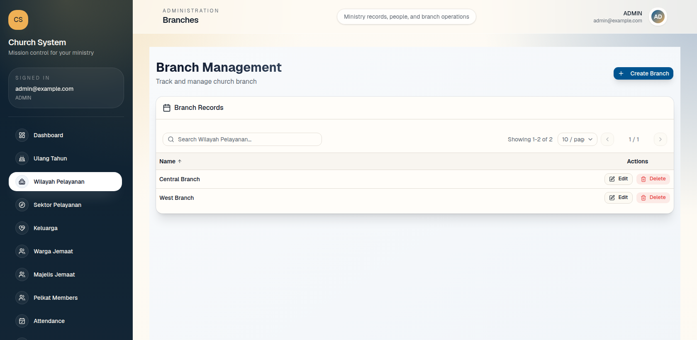

### Menambah wilayah

1. Klik **Create Branch**.
2. Isi **Name**.
3. Klik **Create**.

### Mengganti nama wilayah

Klik **Edit** pada baris, ubah namanya, lalu simpan.

### Menghapus wilayah

Klik **Delete** dan konfirmasi dialog peramban.

> **Peringatan — semua data di bawahnya ikut terhapus.** Menghapus wilayah
> juga menghapus semua sektor di dalamnya, semua keluarga di sektor-sektor
> itu, dan seluruh warganya. Akun koordinator yang ditugaskan ke sektor
> tersebut kehilangan penugasan sektornya. Tindakan ini tidak dapat
> dibatalkan dari aplikasi.

Hanya ADMIN dan STAFF (dengan akses edit) yang melihat tombol ini.

---

## 7. Sektor Pelayanan

**Sektor Pelayanan** adalah sektor di dalam satu wilayah. Keluarga dan warga
jemaat berada di dalam sektor.

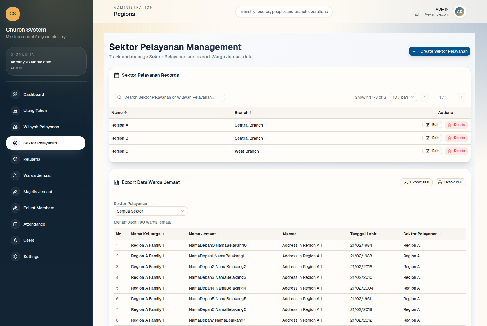

### Menambah sektor

1. Klik **Create Sektor Pelayanan**.
2. Isi **Name**.
3. Pilih **Branch** tempat sektor itu berada.
4. Klik **Create**.

### Mengedit atau menghapus

Gunakan **Edit** untuk mengganti nama sektor atau memindahkannya ke wilayah
lain. Gunakan **Delete** dengan hati-hati:

> **Peringatan — semua data di sektor ini ikut terhapus.** Menghapus sektor
> akan menghapus keluarganya, seluruh warganya, dan penugasan koordinator ke
> sektor tersebut. Tindakan ini tidak dapat dibatalkan dari aplikasi.

### Ekspor warga jemaat per sektor

Di bawah daftar sektor terdapat bagian **Export Data Warga Jemaat**:

1. Pilih sektor di dropdown **Sektor Pelayanan**, atau biarkan
   **Semua Sektor** untuk semua sektor.
2. Tabel pratinjau menampilkan keluarga, warga, alamat, tanggal lahir, dan
   sektor. Urutkan dengan judul kolom.
3. **Export XLS** mengunduh daftar; **Cetak PDF** membuka dialog cetak.

Tombol nonaktif jika tidak ada data untuk diekspor.

---

## 8. Keluarga

**Keluarga** adalah rumah tangga. Setiap warga jemaat harus berada di satu
keluarga, dan setiap keluarga berada di satu sektor.

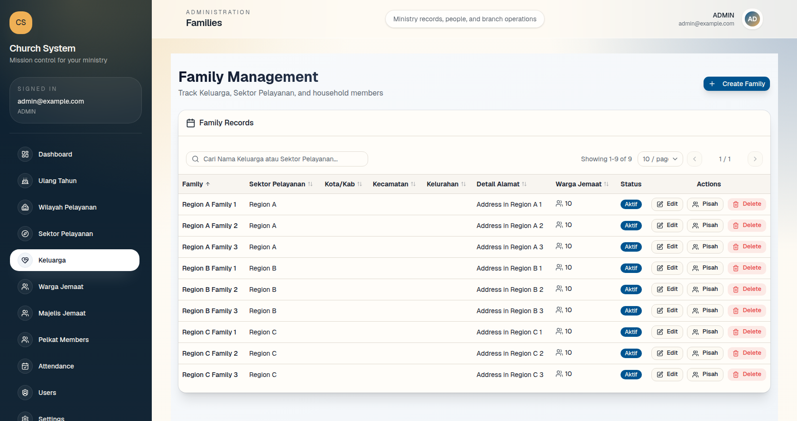

### Daftar keluarga

Kolom: **Family**, **Sektor Pelayanan**, **Kota/Kab**, **Kecamatan**,
**Kelurahan**, **Detail Alamat**, **Warga Jemaat** (jumlah anggota), dan
**Status**.

Badge **Status** menampilkan **Aktif** jika semua anggota aktif, dan **Tidak
Aktif** jika setidaknya ada satu anggota yang tidak aktif. Klik badge untuk
mengubah status seluruh keluarga (lihat di bawah).

### Membuat keluarga

1. Klik **Create Family**.
2. Isi:
   - **Family name** — wajib, biasanya nama marga atau nama rumah tangga.
   - **Sektor Pelayanan** — wajib.
   - **Address (detail)** — wajib, misalnya
     `Jl. Merdeka No. 123, RT 01/RW 02`.
   - **Provinsi**, **Kota/Kabupaten**, **Kecamatan**, **Kelurahan** — keempatnya
     wajib untuk keluarga. Pilih berurutan; setiap dropdown dimuat setelah
     pilihan sebelumnya.
3. Opsional, tambahkan anggota langsung:
   - Klik **Add Member** di bagian **New Warga Jemaat**.
   - Untuk setiap anggota, isi nama depan, tanggal lahir, jenis kelamin,
     hubungan keluarga, dan **Jabatan** (wajib), serta data opsional lain.
   - Klik ikon tempat sampah pada blok anggota untuk membuangnya sebelum
     menyimpan.
4. Klik **Create**.

Anda boleh menunda penambahan anggota dan menambahkannya nanti dari halaman
**Warga Jemaat**.

### Mengedit keluarga

Klik **Edit**. Anda dapat mengubah nama keluarga, sektor, dan alamat.

- Anggota yang sudah ada ditampilkan hanya-baca di bagian **Existing Warga
  Jemaat**. Untuk mengubah data anggota, gunakan halaman **Warga Jemaat**.
- Bagian **New Warga Jemaat** dapat menambah anggota baru saat mengedit.

### Mengubah status seluruh keluarga

Klik badge **Aktif / Tidak Aktif** pada baris keluarga.

- Pilih **Aktif** atau **Tidak Aktif**.
- Jika memilih **Tidak Aktif**, isi **Tanggal Pindah**.
- Klik **Simpan**.

Status diterapkan ke **semua anggota keluarga sekaligus**. Mengembalikan
keluarga ke **Aktif** menghapus tanggal pindah pada semua anggota. Ini cara
tercepat mencatat bahwa satu rumah tangga pindah ke jemaat lain.

### Memisahkan keluarga — **Pisah**

Gunakan fitur ini ketika seorang anggota menjadi kepala rumah tangga sendiri.

1. Klik **Pisah** pada baris keluarga.
   - Keluarga saat ini harus memiliki anggota dengan hubungan **Kepala
     Keluarga**. Jika tidak ada, aplikasi menampilkan
     **"Tidak ada Kepala Keluarga untuk dipisah"**.
2. Dialog **Jadikan … sebagai Kepala Keluarga** terbuka. Nama keluarga baru
   terisi otomatis sebagai `<keluarga asal> - <kepala baru>`; ubah jika perlu.
3. Periksa sektor, alamat, dan data kewilayahan. Semuanya disalin dari
   keluarga asal; ubah jika rumah tangga baru tinggal di tempat lain.
4. Di bagian **Pindahkan Anggota**, hilangkan centang anggota yang tetap
   tinggal di keluarga asal. Kepala baru selalu ikut dan tidak bisa
   dihilangkan centangnya.
   - **Pilih Semua** memilih semua orang; **Hanya KK** menyisakan kepala baru
     saja.
5. Klik **Buat Keluarga Baru**.

Anggota yang dipilih dipindahkan ke keluarga baru, dan hubungan anggota yang
dipilih menjadi **Kepala Keluarga**. Keluarga asal tetap memiliki anggota yang
tidak Anda pilih.

### Menghapus keluarga

Klik **Delete** dan konfirmasi.

> **Peringatan:** menghapus keluarga juga menghapus **semua anggotanya**.
> Gunakan "Tidak Aktif" atau pisahkan keluarga jika Anda hanya perlu mencatat
> kepindahan.

---

## 9. Warga Jemaat

Ini adalah daftar utama warga jemaat.

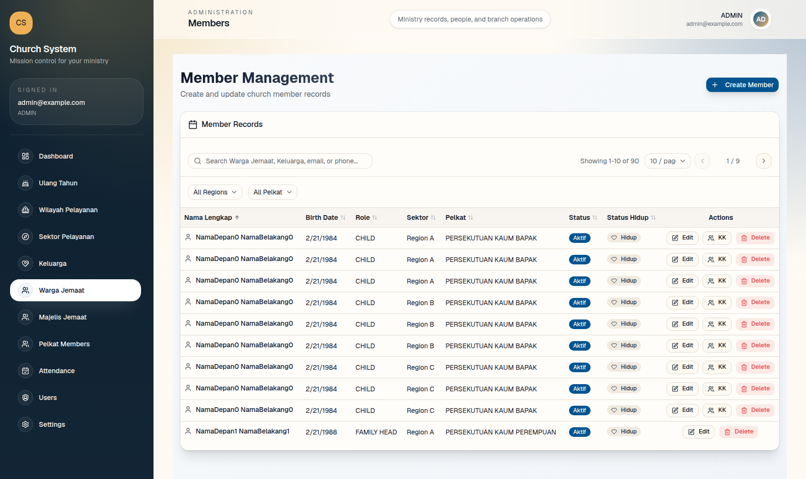

### Daftar warga jemaat

Kolom: **Nama Lengkap**, **Birth Date**, **Role**, **Sektor**, **Pelkat**,
**Status**, **Status Hidup**, dan **Actions**.

- **Pencarian** mencocokkan nama depan/belakang warga, nama keluarga, email,
  dan nomor telepon.
- Saring berdasarkan **Sektor** dan **Pelkat** lewat dropdown.
- Urutkan dengan mengklik judul kolom yang bisa diurutkan. Urutan Pelkat
  memakai kategori hasil perhitungan.
- Badge **Status** (**Aktif** / **Tidak Aktif**) dan **Status Hidup**
  (**Hidup** / **Meninggal**) dapat diklik sebagai jalan pintas; lihat di
  bawah.

### Menambah warga jemaat

1. Klik **Create Member**.
2. **Sektor Pelayanan & Keluarga** (wajib, isi lebih dulu):
   - Pilih **Sektor Pelayanan**.
   - Lalu pilih **Nama Keluarga**. Hanya keluarga di sektor terpilih yang
     ditawarkan. Jika tidak ada, buat keluarganya dulu di halaman **Keluarga**.
3. **Data Diri**:
   - **Nama Depan** (wajib), **Nama Belakang** (opsional).
   - **Kota Lahir** (opsional), **Tanggal Lahir** (wajib).
   - **Nomor Handphone** (opsional).
   - **Jenis Kelamin** — Laki-laki atau Perempuan (wajib).
   - **Golongan Darah** — A, B, AB, O, atau Tidak Diketahui.
   - **Hubungan Keluarga** — wajib; lihat referensi di bagian 17.
   - **Anak ke-** — hanya muncul untuk **Anak**.
4. **Alamat**:
   - Biarkan **Alamat sama dengan keluarga** aktif jika warga tinggal bersama
     keluarganya.
   - Matikan untuk mengisi **Detail Alamat** yang berbeda dan empat pilihan
     kewilayahan (provinsi, kota/kabupaten, kecamatan, kelurahan/desa).
5. **Baptis**, **Sidi**, **Perkawinan**:
   - Pilih statusnya. Jika memilih **Sudah** atau **Menikah**, kolom tambahan
     untuk lokasi dan tanggal akan muncul. Pengisiannya opsional.
6. **Jabatan** — wajib. **Warga Jemaat** adalah nilai normal untuk sebagian
   besar orang. **Diaken** dan **Penatua** juga membuat orang tersebut muncul
   di halaman **Majelis Jemaat**.
7. **Informasi Lainnya** — **Email**, gereja asal, pendidikan, pekerjaan,
   tahun terdaftar, pengalaman gereja/organisasi, dan catatan bebas. Semua
   opsional.
8. **Status** dan **Status Hidup**:
   - **Status** — Aktif atau Tidak Aktif.
   - **Status Hidup** — Hidup atau Meninggal. Memilih **Meninggal** memunculkan
     **Tanggal Meninggal**.
9. Klik **Tambah** untuk menyimpan.

**Pelkat tidak pernah diketik manual.** Pelkat dihitung dari tanggal lahir,
jenis kelamin, dan hubungan keluarga, jadi pastikan data itu benar.

### Mengedit warga jemaat

Klik **Edit** pada baris warga, ubah kolom yang perlu, lalu klik **Simpan**.
Formulir dan aturan yang sama berlaku.

### Mencatat kepindahan — **Status**

Klik badge **Aktif / Tidak Aktif** pada baris warga.

1. Pilih **Tidak Aktif**.
2. Isi **Tanggal Pindah**.
3. Klik **Simpan**.

Gunakan untuk warga yang pindah ke jemaat lain. Memilih **Aktif** lagi akan
menghapus tanggal pindah.

### Mencatat kematian — **Status Hidup**

Klik badge **Hidup / Meninggal**.

1. Pilih **Meninggal**.
2. Isi **Tanggal Meninggal**.
3. Klik **Simpan**.

Ini tidak otomatis membuat warga menjadi tidak aktif. Jika catatan Anda harus
menunjukkan orang tersebut meninggal sekaligus tidak aktif, ubah juga
**Status**. Warga yang meninggal tetap tampil di daftar bersama warga yang
masih hidup.

### Menjadikan warga sebagai kepala keluarga — **KK**

Untuk warga yang saat ini **bukan** **Kepala Keluarga**, tombol **KK** membuka
dialog pisah keluarga yang sama seperti di bagian 8, dengan warga tersebut
sebagai kepala baru. Gunakan untuk membuat rumah tangga baru dari halaman
Warga Jemaat tanpa melewati daftar keluarga. Peringatan yang sama berlaku:
semua anggota yang sudah terpilih akan pindah ke keluarga baru.

### Menghapus warga jemaat

Klik **Delete** dan konfirmasi. Data warga dihapus permanen. Untuk orang yang
pindah, **Tidak Aktif** biasanya adalah pilihan yang tepat, bukan penghapusan.

---

## 10. Majelis Jemaat

Halaman ini menampilkan warga yang **Jabatan**-nya **Diaken** atau **Penatua**.
Tidak ada data majelis terpisah dan tidak ada tombol "Create" di sini.

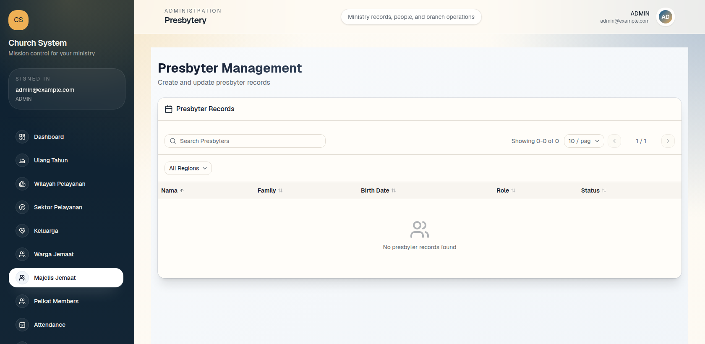

- Untuk menambah majelis, edit warga di halaman **Warga Jemaat** dan atur
  **Jabatan** menjadi **Diaken** atau **Penatua**.
- Untuk mengeluarkan seseorang dari daftar, ubah jabatannya menjadi **Warga
  Jemaat** atau nilai non-majelis lainnya.
- Kolom: nama, sektor keluarga, tanggal lahir, peran, dan status.
- Saring berdasarkan sektor lewat dropdown, cari berdasarkan nama, dan urutkan
  dengan judul kolom.
- Akun berperan **MEMBER** boleh melihat halaman ini tetapi tidak dapat
  mengubah jabatan.
- Jika akun koordinator membukanya, data dibatasi ke sektornya.

---

## 11. Pelkat Members

**Pelkat** adalah pengelompokan pelayanan/usia di gereja. Nilainya dihitung,
bukan disimpan, jadi tidak ada yang perlu diisi di halaman ini. Halaman
menampilkan warga beserta kategori Pelkat hasil perhitungan.

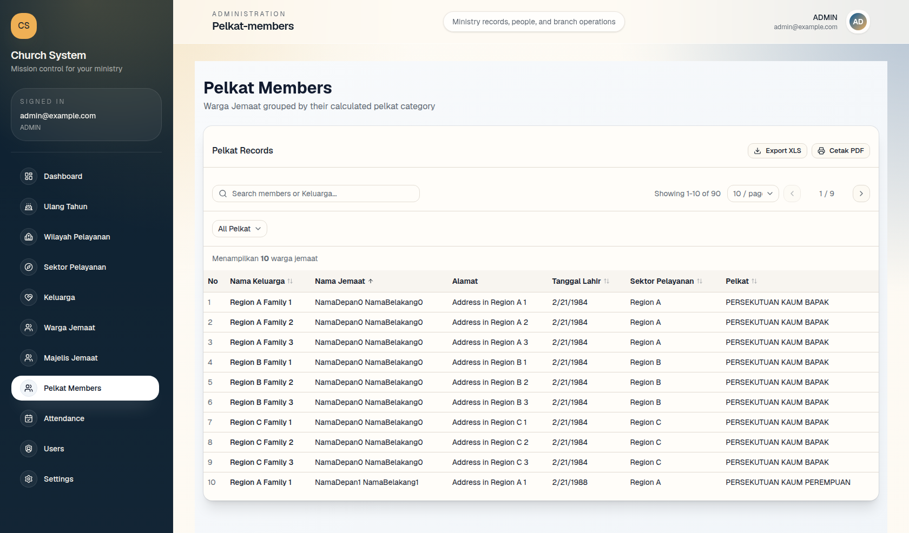

### Cara Pelkat ditentukan

Perhitungan memakai hubungan keluarga (**Kepala Keluarga** atau **Istri**
dianggap menikah), usia saat ini, dan jenis kelamin. Aturan diperiksa dalam
urutan berikut:

| Kondisi | Pelkat |
|---------|--------|
| Menikah (kepala keluarga atau istri) dan usia di bawah 36 | Laki-laki: **Persekutuan Kaum Bapak**; Perempuan: **Persekutuan Kaum Perempuan** |
| Usia 0–12 | **Pelayanan Anak** |
| Usia 13–16 | **Persekutuan Taruna** |
| Usia 17–35 | **Gerakan Pemuda** |
| Usia 36–59 | Laki-laki: **Persekutuan Kaum Bapak**; Perempuan: **Persekutuan Kaum Perempuan** |
| Usia 60+ | **Persekutuan Kaum Lanjut Usia** |

Catatan:

- Kartu Pelkat di dashboard, dan daftar saat Anda memilih Pelkat **tertentu**
  di filter, hanya memuat warga yang **aktif dan hidup**. Tabel tanpa filter
  (semua Pelkat) menampilkan seluruh data warga, termasuk yang tidak aktif
  atau meninggal, beserta kategori hasil hitungnya.
- Pelkat yang salah hampir selalu berarti **Tanggal Lahir**, **Jenis
  Kelamin**, atau **Hubungan Keluarga** yang salah. Perbaiki data warga;
  kategorinya diperbarui otomatis.
- Halaman mendukung filter Pelkat, pencarian nama/keluarga, pengurutan,
  **Export XLS**, dan **Cetak PDF**. Ekspor nonaktif jika daftar kosong.
- Hanya ADMIN dan STAFF secara default.

---

## 12. Attendance

Halaman ini mencatat kehadiran di ibadah.

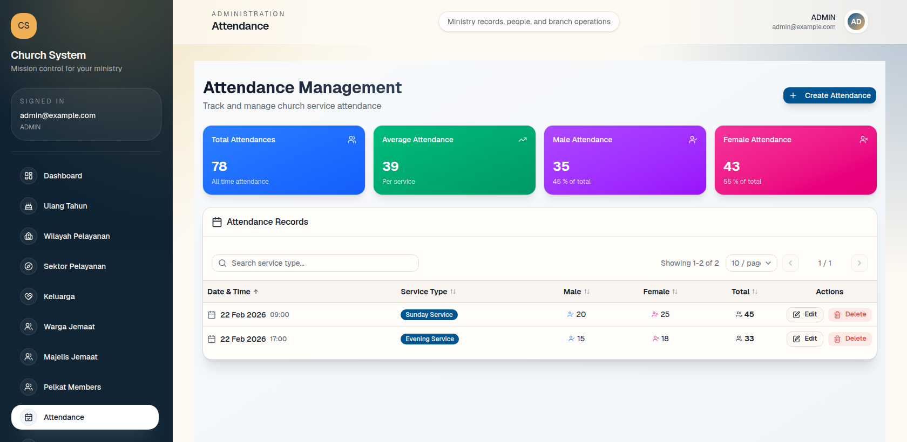

### Kartu ringkasan

Empat kartu menampilkan **Total Attendances**, **Average Attendance**, **Male
Attendance**, dan **Female Attendance**. Angkanya dihitung dari data yang
sedang dimuat di tabel (halaman yang terlihat), jadi berubah saat Anda
mencari, mengurutkan, atau pindah halaman. Ini tampilan cepat, bukan laporan
satu tahun penuh.

### Menambah data kehadiran

1. Klik **Create Attendance**.
2. Isi:
   - **Service Date & Time** — tanggal dan waktu ibadah.
   - **Service Type** — teks bebas, misalnya `Sunday Service` atau
     `Wednesday Service`. Gunakan nama yang konsisten agar filter berfungsi
     baik.
   - **Male Count** dan **Female Count** — bilangan bulat, nol atau lebih.
3. Dialog menampilkan pratinjau **Total Attendance** sebagai jumlah laki-laki
   + perempuan; Anda tidak mengetik totalnya sendiri.
4. Klik **Create**.

**Satu data per ibadah:** tanggal/waktu dan jenis ibadah yang sama tidak bisa
disimpan dua kali. Jika sudah ada, aplikasi menampilkan
**"Attendance already exists for this date and service type"**. Buka data yang
ada dan edit, jangan buat duplikat.

### Mengedit atau menghapus

Gunakan **Edit** atau **Delete** pada baris dan konfirmasi dialog peramban.

### Mencari data

Cari berdasarkan **jenis ibadah**, urutkan berdasarkan tanggal, jenis,
laki-laki, perempuan, atau total, dan pilih 10/20/50 baris per halaman. Urutan
default adalah tanggal ibadah terbaru lebih dulu.

Hanya ADMIN dan STAFF secara default.

---

## 13. Laporan Warga Jemaat

Halaman laporan menyusun daftar warga jemaat datar yang dapat difilter dan
diekspor.

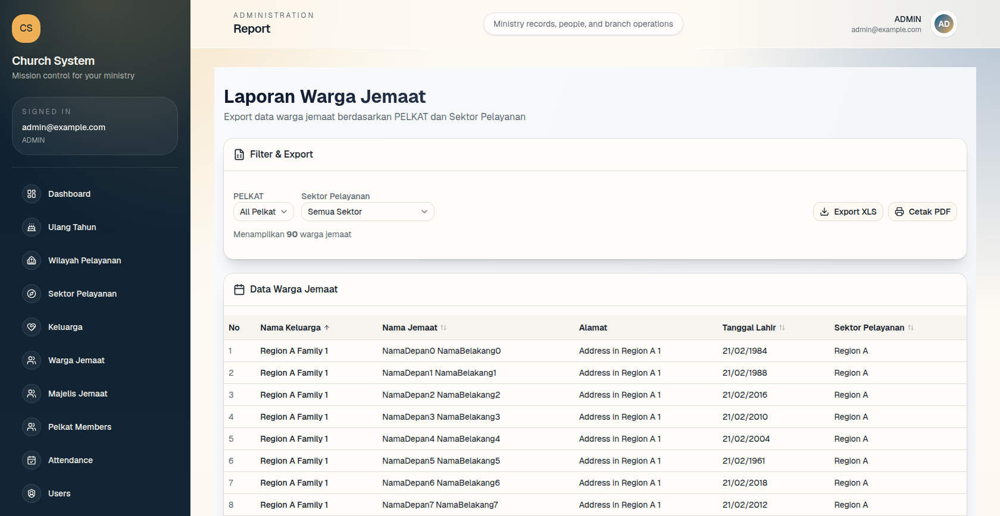

> **Menemukan halaman:** **Report tidak ada di sidebar.** Buka
> `<alamat-dashboard-anda>/dashboard/report` langsung dan simpan sebagai
> bookmark. Hanya ADMIN dan STAFF yang dapat membukanya secara default.

### Cara memakai

1. Pilih **PELKAT** (atau biarkan semua) dan **Sektor Pelayanan** (atau
   **Semua Sektor**). Tabel diperbarui otomatis.
2. Teks di bawah filter menunjukkan berapa warga yang ditampilkan.
3. Klik judul kolom untuk mengurutkan. Urutan disimpan di address bar.
4. **Export XLS** mengunduh `laporan-jemaat.xlsx` berisi nama keluarga, nama
   warga, alamat, tanggal lahir, dan sektor.
5. **Cetak PDF** mengunduh `laporan-jemaat.pdf` dalam orientasi lanskap,
   lengkap dengan judul laporan, filter aktif, total, dan tabel.

Kolom tabelnya adalah **No**, **Nama Keluarga**, **Nama Jemaat**, **Alamat**,
**Tanggal Lahir**, dan **Sektor Pelayanan**. Tombol ekspor nonaktif jika daftar
hasil filter kosong atau masih dimuat.

Laporan memuat **semua data warga jemaat**, termasuk yang berstatus tidak aktif
atau meninggal. Ini berbeda dari kartu Pelkat di dashboard dan dari filter
Pelkat **tertentu** di halaman **Pelkat Members**, yang hanya memuat warga
aktif dan hidup. Gunakan laporan saat membutuhkan daftar lengkap, dan filter
Pelkat saat membutuhkan jumlah kelompok terkini.

---

## 14. Users

Hanya ADMIN yang dapat membuka halaman ini. Halaman ini mengelola **akun
login**, bukan data warga jemaat.

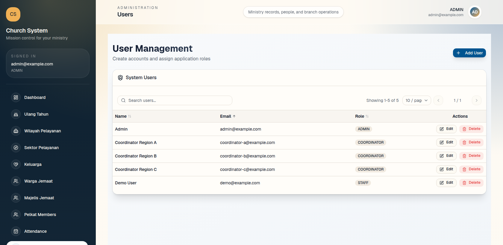

### Menambah pengguna

1. Klik **Add User**.
2. Isi:
   - **Name** — wajib.
   - **Email** — wajib, harus alamat yang valid, dan belum dipakai akun lain.
   - **Password** — wajib untuk pengguna baru, minimal 6 karakter.
   - **Role** — ADMIN, STAFF, COORDINATOR, atau MEMBER.
   - **Sektor Pelayanan** — hanya muncul jika peran **COORDINATOR**, dan wajib
     dalam kasus itu.
3. Klik **Create**.

### Mengedit pengguna

Klik **Edit**. Anda dapat mengubah nama, email, dan peran.

- Biarkan **New password (optional)** kosong untuk mempertahankan password
  saat ini, atau isi password baru (minimal 6 karakter) untuk meresetnya.
- Jika peran atau sektor pengguna diubah, pengguna harus **logout dan login
  lagi** sebelum perubahan berlaku, karena sesinya masih membawa peran saat
  login.

### Menghapus pengguna

Klik **Delete** dan konfirmasi.

- Anda tidak dapat menghapus **akun sendiri**; aplikasi menolak dengan
  **"You cannot delete your own account"**.
- Menghapus pengguna hanya menghapus akun loginnya. Data warga jemaat dan
  keluarga tidak ikut terhapus.

Users berdiri sendiri dari data Warga Jemaat. Membuat akun login tidak membuat
data warga, dan menambah warga tidak membuat akun login.

---

## 15. Pengaturan akses berdasarkan peran

Hanya ADMIN yang dapat membuka Settings, dan pembatasan ini tidak bisa diubah
di matriks.

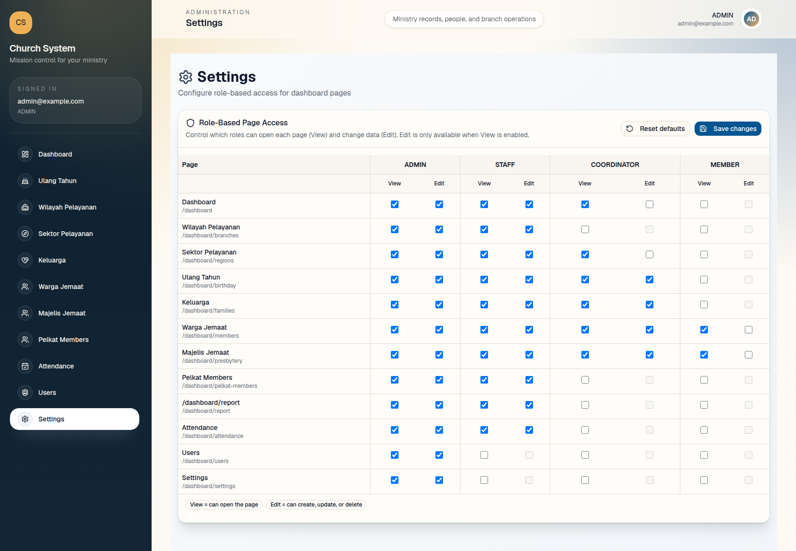

Tabel **Role-Based Page Access** mencantumkan setiap halaman untuk keempat
peran. Setiap peran punya dua kotak centang per halaman:

- **View** — peran dapat membuka halaman dan membaca datanya.
- **Edit** — peran dapat membuat, mengubah, dan menghapus di halaman itu.

Aturan:

- **Edit tidak dapat diaktifkan tanpa View.** Kotak Edit nonaktif sampai View
  dicentang untuk peran tersebut.
- Menghapus centang **View** otomatis menghapus **Edit** untuk peran itu.
- Perubahan baru diterapkan setelah Anda mengklik **Save changes**. **Reset
  defaults** mengembalikan matriks standar di formulir; tetap perlu disimpan.
- Server menegakkan matriks yang sama. Menyembunyikan tombol bukan satu-satunya
  perlindungan: peran tanpa hak edit tetap ditolak server meskipun memanggil
  halaman langsung.

### Setelah menyimpan

- Pengguna mengambil matriks baru saat memuat ulang halaman atau login lagi.
- Jika Anda menghapus akses ADMIN Anda sendiri ke suatu halaman, Anda bisa
  kehilangan halaman itu. Uji perubahan izin dengan akun percobaan terpisah
  agar tidak terkunci sendiri.

---

## 16. Tugas umum, langkah demi langkah

### 16.1 Mendaftarkan rumah tangga baru beserta anggotanya

1. **Keluarga → Create Family**.
2. Isi nama keluarga, pilih sektor, dan lengkapi alamat.
3. Klik **Add Member** untuk setiap orang, isi kolom wajib, lalu klik
   **Create**.
4. Periksa keluarga baru di daftar: jumlah **Warga Jemaat** harus sama dengan
   jumlah orang yang Anda tambahkan.

### 16.2 Menambah orang ke keluarga yang sudah ada

1. **Warga Jemaat → Create Member**.
2. Pilih sektor, lalu keluarga.
3. Isi data pribadi, hubungan keluarga, dan jabatan; simpan.

Alamat warga mengikuti keluarga kecuali Anda mematikan **Alamat sama dengan
keluarga**.

### 16.3 Membuat rumah tangga baru untuk anak dewasa

1. Cari orangnya di **Warga Jemaat** (atau keluarganya di **Keluarga**).
2. Klik **KK** (halaman Warga Jemaat) atau **Pisah** (halaman Keluarga).
3. Sesuaikan nama keluarga baru, sektor, dan alamat.
4. Hilangkan centang orang yang tetap tinggal di keluarga asal.
5. Klik **Buat Keluarga Baru**.

### 16.4 Mencatat warga pindah ke jemaat lain

1. **Warga Jemaat**, klik badge **Aktif** pada barisnya.
2. Pilih **Tidak Aktif** dan isi **Tanggal Pindah**.
3. Simpan.

Jika seluruh rumah tangga pindah, lakukan hal yang sama dari halaman
**Keluarga** agar semua anggota diperbarui sekaligus.

### 16.5 Mencatat kematian

1. **Warga Jemaat**, klik badge **Hidup**.
2. Pilih **Meninggal** dan isi **Tanggal Meninggal**.
3. Simpan.
4. Jika orang tersebut juga harus berhenti dihitung aktif, ubah **Status**
   menjadi **Tidak Aktif**, atau edit warga dan atur kedua kolom sekaligus.

### 16.6 Memperbaiki warga yang salah Pelkat

1. Buka warga di **Warga Jemaat → Edit**.
2. Periksa **Tanggal Lahir**, **Jenis Kelamin**, dan **Hubungan Keluarga**.
3. Perbaiki kolom yang salah lalu simpan. Pelkat berubah otomatis; tidak ada
   kolom Pelkat yang bisa diedit.

### 16.7 Mencatat kehadiran ibadah Minggu lalu

1. **Attendance → Create Attendance**.
2. Isi tanggal dan waktu ibadah serta jenis ibadahnya.
3. Isi jumlah laki-laki dan perempuan.
4. Klik **Create**.

Jika data untuk tanggal dan jenis itu sudah ada, edit data tersebut.

### 16.8 Mencetak daftar ulang tahun minggu ini

1. Buka **Ulang Tahun**.
2. Pilih tanggal di minggu yang diinginkan.
3. Klik **Cetak PDF** dan pilih printer atau "Save as PDF".
4. Gunakan **Export XLS** jika membutuhkan daftar dalam Excel.

### 16.9 Mengekspor warga untuk sektor atau Pelkat

- Untuk **sektor**: halaman **Sektor Pelayanan** → bagian **Export Data Warga
  Jemaat**, atau buka **Report** dan pilih sektornya.
- Untuk **Pelkat**: buka **Report**, pilih Pelkat, lalu **Export XLS** atau
  **Cetak PDF**. Halaman **Pelkat Members** juga dapat mengekspor apa yang
  ditampilkannya.

### 16.10 Membuat akun koordinator

1. Pastikan sektornya sudah ada di **Sektor Pelayanan**.
2. **Users → Add User**.
3. Isi nama, email, dan password minimal 6 karakter.
4. Atur **Role** menjadi **COORDINATOR**.
5. Pilih **Sektor Pelayanan** untuknya.
6. Klik **Create** dan berikan kredensialnya kepada orang tersebut.

### 16.11 Mengubah hak akses suatu peran

1. **Settings**.
2. Centang atau hapus centang **View** dan **Edit** untuk halaman dan peran
   yang dimaksud.
3. Klik **Save changes**.
4. Muat ulang dashboard (atau minta pengguna terkait memuat ulang) dan uji
   dengan akun peran tersebut.

---

## 17. Referensi kolom dan nilai

### Hubungan Keluarga

| Label | Arti |
|-------|------|
| Kepala Keluarga | Kepala rumah tangga |
| Istri | Istri |
| Anak | Anak |
| Orang Tua | Orang tua |
| Cucu | Cucu |
| Kakak/Adik Kandung | Saudara kandung |
| Famili Lain | Kerabat lain |
| Lainnya | Lain-lain |

**Kepala Keluarga** dan **Istri** dianggap menikah saat Pelkat dihitung. Satu
keluarga biasanya memiliki satu **Kepala Keluarga**.

### Jenis Kelamin

**Laki-laki**, **Perempuan**.

### Golongan Darah

**A**, **B**, **AB**, **O**, atau **Tidak Diketahui**. Nilai tidak diketahui
dibiarkan kosong dan tidak dihitung di kartu golongan darah dashboard.

### Sakramen dan pernikahan

| Kolom | Nilai |
|-------|-------|
| Status Baptis | **Sudah**, **Belum** |
| Status Sidi | **Sudah**, **Belum** |
| Status Perkawinan | **Belum Menikah**, **Janda**, **Duda**, **Menikah** |

Kolom lokasi dan tanggal hanya muncul untuk **Sudah** (baptis, sidi) atau
**Menikah** (perkawinan). Isinya opsional.

### Jabatan

| Label | Arti |
|-------|------|
| Warga Jemaat | Warga biasa (default) |
| Diaken | Diaken — muncul di **Majelis Jemaat** |
| Penatua | Penatua — muncul di **Majelis Jemaat** |
| Pengurus PELKAT | Pengurus Pelkat |
| Pengurus Komisi | Pengurus komisi |

Hanya **Diaken** dan **Penatua** yang dianggap majelis jemaat.

### Status, Status Hidup, dan tanggal

| Kolom | Arti |
|-------|------|
| Status **Aktif** | Warga saat ini menjadi bagian jemaat. |
| Status **Tidak Aktif** | Warga sudah pindah/keluar. Dapat disertai **Tanggal Pindah**. |
| Status Hidup **Hidup** | Masih hidup. |
| Status Hidup **Meninggal** | Sudah meninggal. Dapat disertai **Tanggal Meninggal**. |

Status dan Status Hidup berdiri sendiri: warga yang meninggal tidak otomatis
menjadi tidak aktif.

### Aturan alamat

- Keluarga wajib mengisi keempat tingkat kewilayahan (provinsi,
  kota/kabupaten, kecamatan, kelurahan) plus detail jalan.
- Warga mewarisi alamat keluarga secara default.
- Mematikan **Alamat sama dengan keluarga** memungkinkan Anda menyimpan alamat
  terpisah untuk warga itu; jika tidak, kolom alamat khusus warga akan
  dikosongkan saat menyimpan.

### Tanggal dan bahasa

Tanggal ditampilkan dalam format Indonesia (`dd/mm/yyyy`) dan tanggal panjang
memakai nama bulan Indonesia. Antarmuka mencampur judul halaman dan nama kolom
Indonesia dengan sebagian label Inggris. Ekspor memakai judul kolom Indonesia.

---

## 18. Pemecahan masalah dan FAQ

**"Invalid email or password"**
Periksa ejaan email, huruf besar/kecil password, dan Caps Lock. Jika tetap
gagal, minta administrator mereset password di **Users**. Tidak ada tautan
"lupa password".

**Item menu tidak muncul**
Peran Anda tidak memiliki **View** untuk halaman itu. Bandingkan dengan
bagian 3 atau tanyakan ke administrator. Visibilitas menu mengikuti matriks
yang sama dengan akses halaman.

**Saya melihat "Access Restricted"**
Peran Anda tidak boleh melihat halaman itu. Klik **Go to your dashboard**. Jika
Anda membutuhkan akses, administrator dapat memberikannya di **Settings**.

**Saya tidak melihat Create / Edit / Delete**
Anda punya View tetapi tidak punya Edit untuk halaman itu. Tombol
disembunyikan untuk peran baca-saja, dan server juga menolak perubahan.

**Tidak ada keluarga setelah memilih sektor**
Sektor itu belum memiliki keluarga. Buat keluarganya dulu di **Keluarga**.
Keluarga baru juga harus disimpan sebelum bisa dipilih untuk warga.

**Keluarga tidak bisa dibuat**
Pastikan nama keluarga dan alamat sudah diisi, dan provinsi,
kota/kabupaten, kecamatan, serta kelurahan semuanya dipilih. Keempat pilihan
kewilayahan wajib untuk keluarga.

**"Tidak ada Kepala Keluarga untuk dipisah"**
Keluarga tidak memiliki anggota dengan hubungan **Kepala Keluarga**, jadi tidak
ada yang bisa dijadikan kepala. Atur **Hubungan Keluarga** salah satu anggota
menjadi **Kepala Keluarga** terlebih dahulu, atau gunakan tombol **KK** pada
baris warga untuk memilih kepala baru langsung.

**"Attendance already exists for this date and service type"**
Sudah ada data dengan tanggal/waktu dan jenis ibadah yang sama. Cari di daftar
kehadiran dan edit data itu, atau ubah tanggal/waktu/jenisnya.

**Tombol ekspor atau cetak nonaktif**
Tidak ada data pada tampilan saat ini. Hapus filter atau pilih rentang yang
memiliki data. Ekspor juga menunggu proses pemuatan selesai.

**Saya sudah menyimpan izin tetapi pengguna masih melihat menu lama**
Muat ulang halaman agar pengaturan izin terbaru diambil, atau minta pengguna
logout dan login lagi. Jika **peran** atau **sektor** mereka diubah, mereka
wajib login ulang.

**Koordinator tidak bisa melihat sektor lain**
Itu memang disengaja. Akun koordinator dibatasi ke sektor pada akunnya.
Administrator harus mengubah sektor yang ditetapkan di **Users**.

**Total dashboard berbeda dari kartu Pelkat**
Total menghitung semua data, sedangkan Pelkat hanya menghitung warga aktif dan
hidup. Lihat bagian 4.

**Angka tidak langsung berubah setelah edit**
Aplikasi menyimpan cache daftar untuk sementara. Muat ulang halaman untuk
memaksa data terbaru.

**Saya tidak bisa membuka Report dari menu**
Report memang tidak ada di sidebar. Buka `/dashboard/report` langsung dan
simpan sebagai bookmark.

**Data hilang atau saya salah menghapus**
Penghapusan bersifat permanen. Tidak ada undo atau tempat sampah di aplikasi.
Minta pengelola basis data memulihkan dari cadangan.

**Sesi saya berakhir tiba-tiba**
Masuk kembali. Jika sering terjadi, beri tahu administrator; server mungkin
dimulai ulang atau kunci sesi berubah.

**Hasil cetak terpotong**
Di dialog cetak, pilih orientasi lanskap dan aktifkan "Background graphics".
Untuk daftar besar, ekspor ke XLS biasanya lebih mudah diolah.

**Di mana saya mengubah password sendiri?**
Tidak ada halaman password mandiri. Administrator mengubahnya di halaman
**Users**. Pilih password minimal 6 karakter.

---

## 19. Keamanan data

Perlakukan tindakan berikut dengan hati-hati; semuanya tidak dapat dibatalkan
di dalam aplikasi.

| Tindakan | Data yang ikut terhapus |
|----------|-------------------------|
| Hapus **Wilayah Pelayanan** | Semua sektor, keluarga, dan warga di bawahnya; penugasan koordinator dibersihkan. |
| Hapus **Sektor Pelayanan** | Semua keluarga dan warga di dalamnya; penugasan koordinator dibersihkan. |
| Hapus **Keluarga** | Semua anggota keluarga itu. |
| Hapus **Warga Jemaat** | Data warga itu saja. |
| Hapus **User** | Akun login saja. Data warga tidak terpengaruh. |

Panduan praktis:

- Gunakan **Tidak Aktif** plus **Tanggal Pindah** untuk orang yang keluar,
  bukan menghapus.
- Gunakan **Pisah** atau **KK** untuk memisahkan rumah tangga, bukan menghapus
  lalu memasukkan ulang warga.
- Sebelum menghapus sektor atau wilayah, ekspor daftar warganya (**Report**
  atau ekspor sektor) agar Anda punya salinan.
- Simpan setidaknya satu akun ADMIN yang Anda kendalikan, dan hindari mencabut
  akses Anda sendiri saat mengedit izin.
- Data warga bersifat pribadi. Bagikan ekspor hanya kepada pihak yang
  membutuhkan dan simpan dengan aman.

---

## 20. Lampiran: peta menu dan akun demo

### Peta halaman

| Label sidebar | Alamat | Fungsi |
|---------------|--------|--------|
| Dashboard | `/dashboard` | Ringkasan angka dan tabel sektor |
| Ulang Tahun | `/dashboard/birthday` | Ulang tahun mingguan |
| Wilayah Pelayanan | `/dashboard/branches` | Data wilayah |
| Sektor Pelayanan | `/dashboard/regions` | Data sektor dan ekspor sektor |
| Keluarga | `/dashboard/families` | Data rumah tangga |
| Warga Jemaat | `/dashboard/members` | Daftar warga jemaat |
| Majelis Jemaat | `/dashboard/presbytery` | Majelis jemaat (turunan) |
| Pelkat Members | `/dashboard/pelkat-members` | Warga menurut Pelkat |
| Attendance | `/dashboard/attendance` | Kehadiran ibadah |
| Users | `/dashboard/users` | Akun login |
| Settings | `/dashboard/settings` | Matriks akses peran |
| *(tanpa menu)* | `/dashboard/report` | Laporan terfilter dan ekspor |

### Akun demo bawaan

Jika instalasi Anda disiapkan dengan data contoh (`npm run prisma:seed`),
akun berikut tersedia. Ganti atau hapus akun ini di instalasi sungguhan.

| Email | Password | Peran |
|-------|----------|-------|
| `admin@example.com` | `admin123` | ADMIN |
| `demo@example.com` | `demo1234` | STAFF |

### Dokumentasi terkait

- [README.md](../README.md) — ringkasan proyek dan penyiapan
- [QUICK_START.md](QUICK_START.md) — panduan cepat satu halaman untuk petugas baru
- [PROJECT_DOCUMENTATION.md](PROJECT_DOCUMENTATION.md) — arsitektur, pengembangan, pengujian, dan operasi
- [PRD.md](PRD.md) — kebutuhan produk, ruang lingkup, dan rencana rilis
- [API.md](API.md) — endpoint API
- [DATA_MODEL.md](DATA_MODEL.md) — entitas dan relasi basis data
- [AUTH_RBAC.md](AUTH_RBAC.md) — detail autentikasi dan izin
